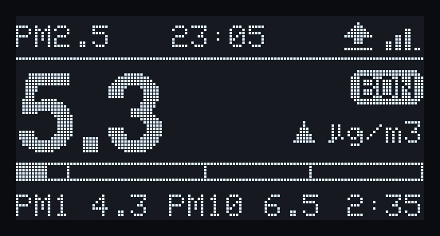
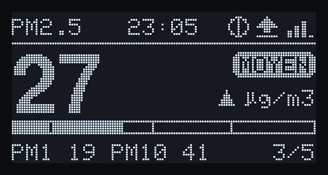
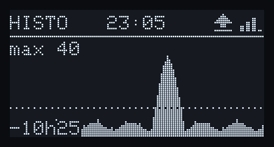
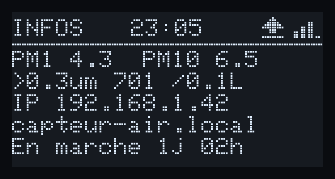
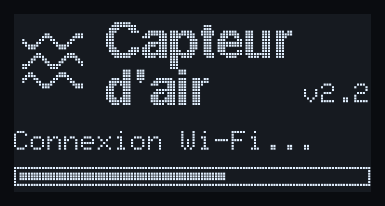
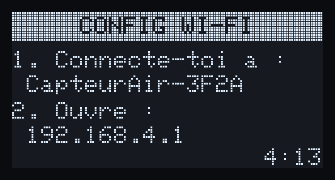
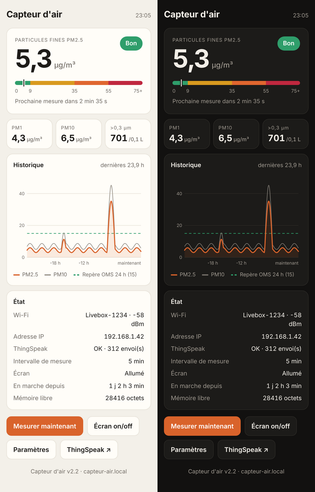
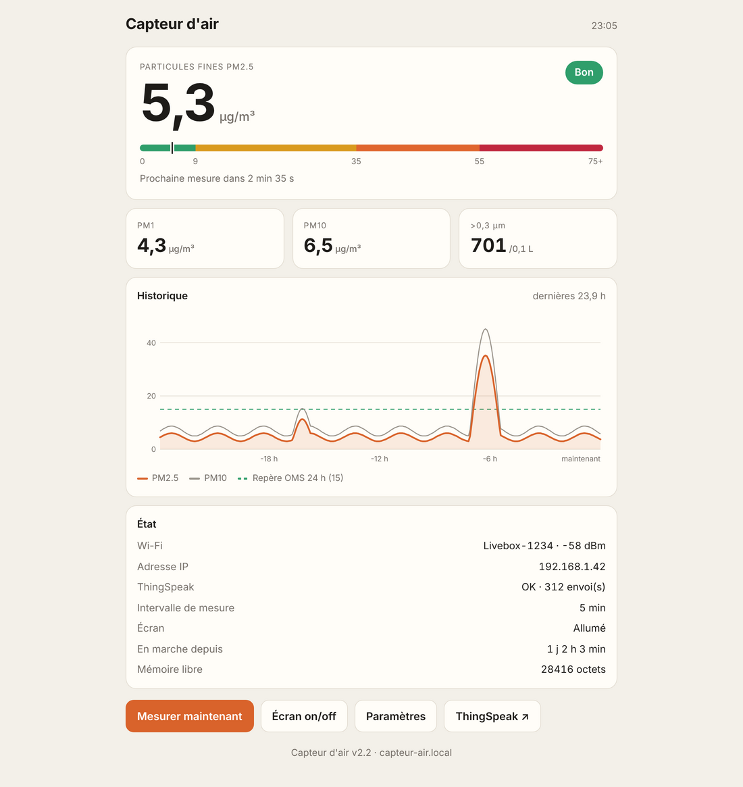
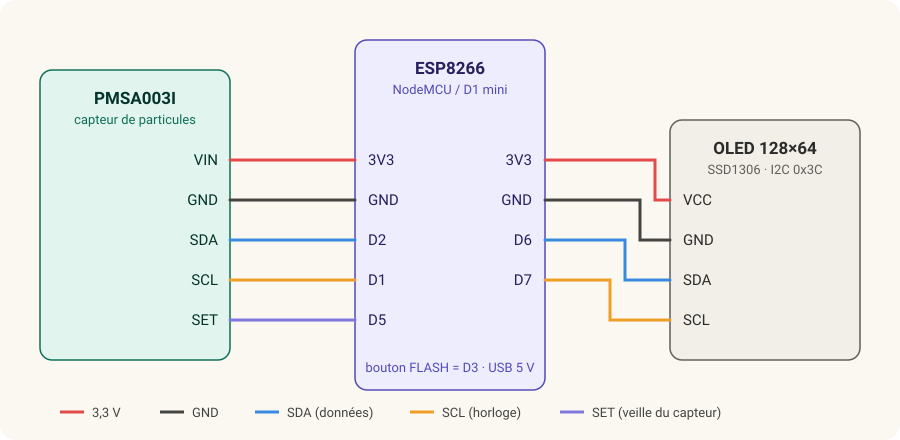

# Capteur d'air

Moniteur de particules fines connecté, construit autour d'un **ESP8266**, d'un capteur laser **Plantower PMSA003I** et d'un petit écran **OLED**.
Il mesure en continu les PM1, PM2.5 et PM10 d'une pièce, les affiche sur l'écran, les sert sur une page web locale et peut les envoyer sur **ThingSpeak** pour garder un historique consultable depuis un téléphone.

<p align="center">
  
</p>

## Sommaire

- [Fonctionnalités](#fonctionnalités)
- [Aperçu](#aperçu)
- [Matériel](#matériel)
- [Câblage](#câblage)
- [Installation](#installation)
- [Premier démarrage](#premier-démarrage)
- [Utilisation](#utilisation)
- [Lire les mesures](#lire-les-mesures)
- [Boîtier « Atmos 77 »](#boîtier--atmos-77-)
- [Dépannage](#dépannage)
- [Pistes d'évolution](#pistes-dévolution)
- [Licence](#licence)

## Fonctionnalités

- **Mesure PM1 / PM2.5 / PM10** et comptage des particules par taille, moyennés sur chaque cycle.
- **Économie du capteur** : le ventilateur et le laser sont coupés entre deux mesures (broche `SET`), ce qui prolonge nettement la durée de vie du PMSA003I.
- **Écran OLED** à trois pages : valeur principale avec jauge et tendance, historique des dernières heures, informations réseau.
- **Configuration Wi-Fi sans toucher au code** : au premier démarrage, le capteur crée son propre réseau et une page de configuration (WiFiManager).
- **Page web locale** sur `http://capteur-air.local` : valeurs en direct, courbe sur 24 h, état, réglages.
- **ThingSpeak** (facultatif) : envoi des moyennes, avec nouvelles tentatives automatiques en cas d'échec.
- **Mise à jour par Wi-Fi (OTA)** depuis l'IDE Arduino, sans câble USB.
- **Robustesse** : déblocage du bus I2C, détection et réinitialisation automatique du capteur, rejet des lectures incohérentes, reconnexion Wi-Fi.
- **Journal série détaillé** et commandes de diagnostic.

## Aperçu

### Écran

| Page principale | Pendant une mesure |
|---|---|
|  |  |
| **Historique** | **Informations** |
|  |  |
| **Démarrage** | **Configuration Wi-Fi** |
|  |  |

Ces images sont générées à partir du code d'affichage réel du firmware, compilé sur PC avec la bibliothèque Adafruit GFX.

Barre du haut, de gauche à droite : page affichée, heure, ventilateur animé (mesure en cours), flèche d'envoi ThingSpeak (fixe = envoyé, clignotante = en attente, `!` = erreur), force du signal Wi-Fi (`AP` quand le portail de configuration est ouvert).

### Page web

<p align="center">
  
</p>

<details>
<summary>Version ordinateur</summary>



</details>

## Matériel

| Composant | Rôle | Remarque |
|---|---|---|
| [Adafruit PMSA003I](https://www.adafruit.com/product/4632) | Capteur de particules laser, I2C (0x12) | La carte Adafruit intègre un élévateur 5 V pour le ventilateur : elle s'alimente en 3,3 V |
| ESP8266 NodeMCU 1.0 (ESP-12E) ou Wemos D1 mini | Microcontrôleur Wi-Fi | Le code est testé sur NodeMCU |
| OLED 0,96" 128×64 SSD1306, I2C | Affichage | Adresse 0x3C (souvent notée « 0x78 » sur la carte, en 8 bits) |
| Câble USB + chargeur de téléphone | Alimentation | Environ 100 mA de plus pendant que le ventilateur tourne |
| Câbles STEMMA QT / Dupont | Liaisons | Le PMSA003I a deux connecteurs STEMMA QT |

Tes photos du montage vont dans [`docs/photos/`](docs/photos/).

## Câblage



| PMSA003I | ESP8266 | | OLED | ESP8266 |
|---|---|---|---|---|
| VIN | 3V3 | | VCC | 3V3 |
| GND | GND | | GND | GND |
| SDA | D2 (GPIO4) | | SDA | D6 (GPIO12) |
| SCL | D1 (GPIO5) | | SCL | D7 (GPIO13) |
| SET | D5 (GPIO14) | | | |

Le capteur et l'écran sont sur **deux bus I2C séparés** (réglage `DEUX_BUS_I2C 1`), ce qui permet de tout brancher avec des connecteurs, sans soudure ni dérivation.
Pour tout mettre sur un seul bus (D2/D1), passe `DEUX_BUS_I2C` à `0`.


Le bouton **FLASH** de la NodeMCU (D3) sert de bouton utilisateur. Sur une D1 mini, qui n'en a pas, un bouton poussoir entre D3 et GND fait la même chose.

## Installation

1. **IDE Arduino** avec le paquet de cartes **ESP8266** (Gestionnaire de cartes, URL `https://arduino.esp8266.com/stable/package_esp8266com_index.json`).
2. **Bibliothèques** à installer depuis le Gestionnaire de bibliothèques :
   - Adafruit PM25 AQI
   - Adafruit SSD1306
   - Adafruit GFX Library
   - ThingSpeak (MathWorks)
   - WiFiManager (tzapu, version 2.x)
3. **Réglages de la carte** (menu Outils) :
   - Carte : `NodeMCU 1.0 (ESP-12E Module)` ou `LOLIN(WEMOS) D1 mini`
   - Flash Size : une option avec système de fichiers, par exemple `4MB (FS:2MB OTA:~1019KB)`
   - Upload Speed : `115200` si le téléversement échoue à des vitesses plus élevées
4. Ouvre `firmware/capteur_air/capteur_air.ino` (le fichier `web.h` s'ouvre dans un second onglet) et téléverse.

Aucun identifiant n'est écrit dans le code : le Wi-Fi et ThingSpeak se configurent depuis le téléphone.

## Premier démarrage

1. Au premier démarrage, l'écran affiche **CONFIG WI-FI** et le capteur crée le réseau **CapteurAir-XXXX**.
2. Connecte ton téléphone à ce réseau. La page de configuration s'ouvre automatiquement (sinon, va sur `http://192.168.4.1`).
3. Choisis ton réseau Wi-Fi (2,4 GHz uniquement), saisis le mot de passe et, si tu le souhaites, ton **Channel ID** et ta **Write API Key** ThingSpeak.
4. Le capteur se connecte ; l'adresse de la page web s'affiche sur la page **INFOS** de l'écran.

Le portail reste ouvert 5 minutes. Il se rouvre avec un appui de 3 s sur le bouton FLASH, depuis la page web, ou automatiquement après 15 minutes sans Wi-Fi.

### ThingSpeak

Crée un canal sur [thingspeak.mathworks.com](https://thingspeak.mathworks.com) avec quatre champs :

| Champ | Contenu |
|---|---|
| Field 1 | PM1.0 (µg/m³) |
| Field 2 | PM2.5 (µg/m³) |
| Field 3 | PM10 (µg/m³) |
| Field 4 | Particules > 0,3 µm (par 0,1 L) |

Chaque envoi transmet aussi un statut (temps de fonctionnement, signal Wi-Fi, mémoire libre), visible dans l'onglet *Status* du canal. L'offre gratuite impose au moins 15 s entre deux envois ; le firmware s'y conforme.

## Utilisation

### Cycle de mesure

Par défaut, toutes les **5 minutes** :

1. réveil du capteur (`SET` à l'état haut) et chauffe de 30 s ;
2. mesure pendant 10 s (une lecture toutes les 2 s) ;
3. calcul de la moyenne, ajout à l'historique et envoi à ThingSpeak ;
4. mise en veille du capteur jusqu'au cycle suivant.

L'intervalle se règle de 1 à 60 minutes sur la page **Paramètres**.

### Bouton FLASH

| Appui | Action |
|---|---|
| Court | Page suivante, ou rallume l'écran s'il est éteint |
| 3 secondes | Ouvre le portail de configuration Wi-Fi |

### Page web

| Adresse | Contenu |
|---|---|
| `/` | Tableau de bord |
| `/config` | Paramètres : ThingSpeak, intervalle, extinction de l'écran la nuit, Wi-Fi |
| `/api` | Données au format JSON (valeurs, état, historique) |

### Mise à jour par Wi-Fi

Une fois le capteur connecté, il apparaît dans **Outils > Port** de l'IDE Arduino sous le nom `capteur-air`. Sélectionne-le et téléverse normalement. L'écran affiche la progression.

### Commandes série (115200 bauds)

| Touche | Action |
|---|---|
| `h` | Aide |
| `s` | État complet (capteur, Wi-Fi, ThingSpeak, compteurs) |
| `m` | Lancer une mesure immédiatement |
| `p` | Page d'écran suivante |
| `e` | Écran allumé / éteint |
| `i` | Scan des bus I2C |
| `w` | Ouvrir le portail Wi-Fi |
| `x` | Oublier le réseau Wi-Fi et redémarrer |
| `r` | Redémarrer |

### Réglages dans le code

Les principaux réglages sont regroupés en tête de `capteur_air.ino` :

| Constante | Défaut | Rôle |
|---|---|---|
| `DEUX_BUS_I2C` | `1` | Écran sur D6/D7 (`1`) ou avec le capteur sur D2/D1 (`0`) |
| `UTILISER_SET` | `1` | `0` si la broche SET n'est pas câblée (capteur toujours actif) |
| `CYCLE_MIN_DEFAUT` | `5` | Intervalle de mesure initial, en minutes |
| `DEBUG_CHAQUE_LECTURE` | `1` | Détail de chaque lecture dans le journal série |
| `PORTAIL_MDP` | `""` | Mot de passe du réseau de configuration (8 caractères minimum) |
| `OTA_MDP` | `""` | Mot de passe des mises à jour par Wi-Fi |

## Lire les mesures

| PM2.5 (µg/m³) | Qualité affichée |
|---|---|
| 0 – 9 | Bon |
| 9 – 35 | Moyen |
| 35 – 55 | Mauvais |
| 55 – 125 | Très mauvais |
| > 125 | Dangereux |

Ces seuils s'inspirent de l'indice de qualité de l'air américain (EPA, révision 2024). Le repère pointillé des graphiques correspond à la recommandation de l'OMS de **15 µg/m³ en moyenne sur 24 h** (5 µg/m³ en moyenne annuelle).

Quelques clés de lecture :

- **PM2.5 et PM1** viennent surtout de la combustion : cuisine, bougies, encens, chauffage au bois, trafic.
- **PM10 nettement plus haut que PM2.5** : poussière remuée (ménage, lit), pollen.
- Un **pic court** est normal ; ce qui compte, c'est le niveau de fond et la moyenne sur la durée.
- Au-delà d'environ **80 % d'humidité**, le capteur compte les gouttelettes d'eau et surestime.
- Le PMSA003I est précis à environ ±10 µg/m³ sous 100 µg/m³ : idéal pour suivre des tendances et comparer, moins pour une valeur absolue.

## Boîtier « Atmos 77 »

Boîtier imprimé en 3D d'inspiration années 70, conçu pour ce projet. Les fichiers de modélisation et d'impression vont dans [`boitier/`](boitier/).

Points à respecter pour tout boîtier :

- la **face d'entrée et de sortie d'air** du capteur (un grand côté) doit être plaquée contre une grille, avec un joint en mousse pour que l'air rejeté ne soit pas réaspiré ;
- une cloison entre le capteur et l'ESP8266 limite l'influence de la chaleur ;
- pose l'appareil entre 1 et 1,5 m de hauteur, loin des fenêtres, radiateurs et humidificateurs.

## Dépannage

| Symptôme | Cause probable et solution |
|---|---|
| `Failed to connect to ESP8266: Timed out waiting for packet header` | Le reset automatique de la carte a échoué. Pendant `Connecting...`, maintiens **FLASH**, appuie sur **RST**, relâche FLASH quand le pourcentage défile. Essaie aussi un autre câble USB (données) et `Upload Speed 115200`. Après le premier envoi, préfère l'OTA. |
| `PMSA003I introuvable` / `Capteur absent` | Vérifie que le ventilateur tourne. Lance `i` : si `0x12` n'apparaît pas, vérifie l'alimentation, SDA/SCL et le fil SET. |
| Écran noir | Vérifie `DEUX_BUS_I2C` par rapport à ton câblage, puis lance `i` : l'OLED doit apparaître en `0x3C` (`0x3D` sur certains modules, à changer dans `OLED_ADDR`). |
| ThingSpeak `code 400` | Clé refusée : il faut la **Write API Key** (16 caractères) du bon canal. Corrige-la dans **Paramètres**. |
| Pas de connexion Wi-Fi (`raison 201`) | Réseau introuvable : l'ESP8266 ne voit que le **2,4 GHz**. |
| Pas de connexion Wi-Fi (`raison 15` ou `202`) | Mot de passe incorrect : rouvre le portail (appui 3 s sur FLASH). |
| `capteur-air.local` ne répond pas | Certains téléphones Android ne gèrent pas mDNS : utilise l'adresse IP affichée sur la page INFOS. |

Note technique : la bibliothèque **Adafruit PM25 AQI 2.x** n'accepte qu'un seul appel à `begin_I2C()` (les suivants renvoient toujours `false`). Le firmware l'appelle une seule fois et détecte ensuite le capteur lui-même, par une sonde I2C à l'adresse 0x12.

## Pistes d'évolution

- Capteur **CO₂** Sensirion SCD40/SCD41 (avec température et humidité) : deuxième valeur principale à l'écran, et signalement des mesures de particules faussées par l'humidité.
- **Détecteur de présence (PIR)** pour rallumer l'écran à l'approche, en complément de l'extinction de nuit.
- Indicateur de **niveau sonore** nocturne.

## Structure du dépôt

```
firmware/capteur_air/   firmware ESP8266 (capteur_air.ino + page web web.h)
outils/i2c_scanner/     scanner I2C de diagnostic (deux bus)
boitier/                fichiers du boîtier « Atmos 77 »
docs/                   schéma de câblage, captures, photos
```

## Licence

Distribué sous licence MIT. Voir [LICENSE](LICENSE).
